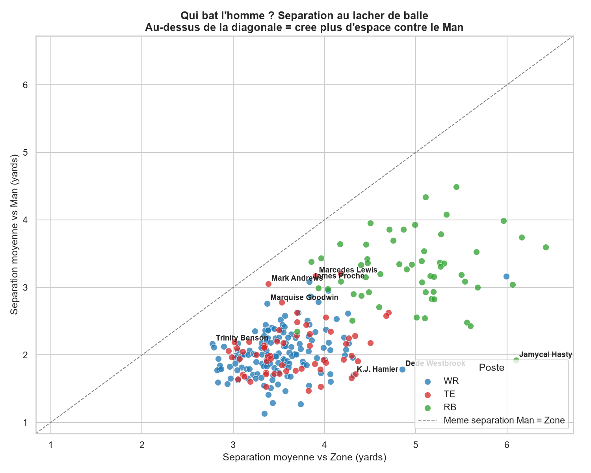
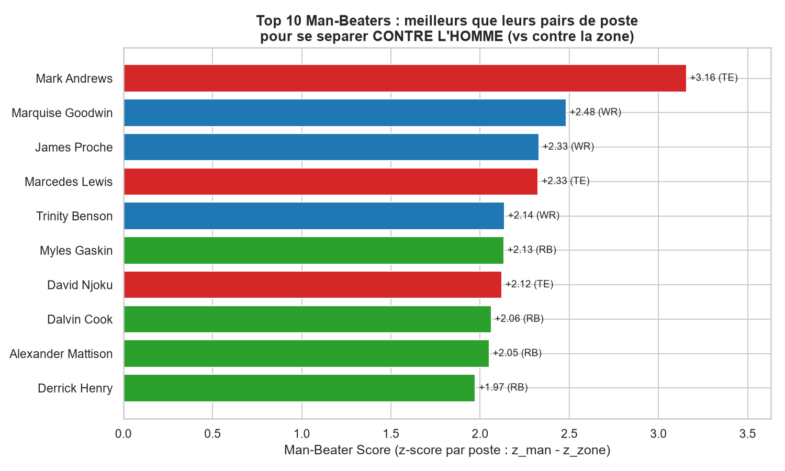
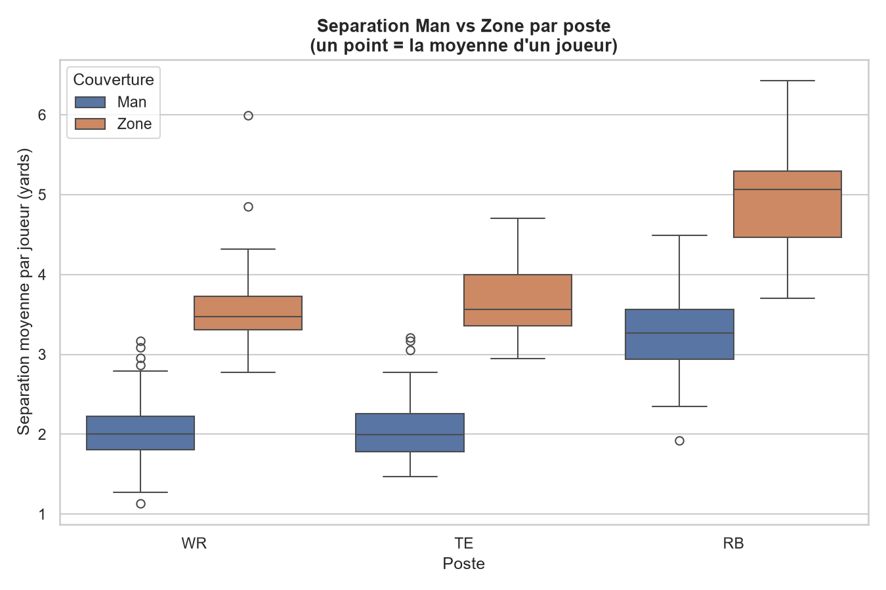

# Man-Beater Score — NFL Big Data Bowl (Paris Side Quest)

**L'insight :** la séparation d'un receveur chute pour presque tout le monde face
à une couverture homme-à-homme (~2.1 yd) comparée à la zone (~3.7 yd) — mais
certains joueurs encaissent cette compression bien mieux que leurs pairs de poste.
J'ai construit le **Man-Beater Score**, qui mesure, au moment où le QB lâche le
ballon, de combien un receveur (WR/TE/RB) se sépare mieux que la moyenne de son
poste **contre l'homme** plutôt que contre la zone. Mark Andrews (TE) ressort
largement en tête, confirmant sa réputation de cible fiable en couverture
individuelle. Un **coordinateur offensif** l'utilise pour choisir qui aligner face
à une défense en man, un **recruteur** pour repérer un profil qui bat l'homme, et
un **commentateur** pour une histoire visuelle en trois secondes.

## Aperçu

Qui bat l'homme ? Chaque point est un joueur ; au-dessus de la diagonale = crée plus
d'espace contre le Man que contre la Zone.



Top 10 des Man-Beaters (score normalisé par poste) :



Séparation Man vs Zone par poste :



## Comment lancer

```bash
pip install -r requirements.txt
python main.py                 # pipeline complet (lit les 122 fichiers tracking, ~15 s)
python main.py --reuse-cache   # réutilise le CSV intermédiaire déjà extrait
python animation.py            # bonus : animation Plotly d'une action exemple
```

Les données attendues sont dans `nfl-big-data-bowl-regional-event-data-main/data/`.
Sorties générées dans `outputs/` :
- `01_scatter_man_vs_zone.png` — séparation vs Man (Y) contre vs Zone (X), un point par joueur, diagonale de référence.
- `02_top10_man_beaters.png` — Top 10 des Man-Beaters.
- `03_separation_by_position.png` — distribution Man vs Zone par poste.
- `04_animation_man_beater.html` — **bonus** : animation interactive d'une passe complétée à Mark Andrews, où la séparation au défenseur le plus proche se creuse image par image.
- `receiver_separation.csv` — table par joueur (séparations, scores, tailles d'échantillon).

## Méthode

1. On ne garde que les actions de passe où `pff_passCoverageType` vaut `Man` ou `Zone`.
2. On ne garde que les coureurs de route (`pff_role == "Pass Route"`) aux postes WR, TE, RB.
3. À l'image `event == "pass_forward"`, on calcule pour chaque receveur la distance
   euclidienne au défenseur le plus proche (joueur de l'équipe en défense présent sur
   l'image) via `scipy.spatial.distance.cdist`. C'est la **séparation**.
4. Agrégation par joueur : séparation moyenne vs Man, vs Zone, et nombre d'actions.
5. Seuils d'échantillon : ≥ 30 actions au total, et ≥ 10 dans chaque type de couverture.
6. **Man-Beater Score** = `z(sep_man) − z(sep_zone)`, où chaque z-score est calculé
   **par poste** (moyenne et écart-type du poste). Un score positif = le joueur se
   sépare mieux que ses pairs de poste contre l'homme qu'il ne le fait contre la zone.

### Pourquoi normaliser par poste ?
Le score brut `sep_man − sep_zone` est négatif pour 256/256 joueurs : il mesure
l'effet universel de la couverture homme, pas le talent individuel. Les RB ont en
plus une séparation absolue bien plus élevée (souvent couverts par des linebackers),
ce qui les décalerait artificiellement. La normalisation par poste compare chaque
joueur à ses pairs et rend le score discriminant et interprétable.

## Hypothèses et limites

- **Un seul instant.** La séparation est mesurée uniquement à `pass_forward` ; elle
  ne capture ni la séparation à l'arrivée du ballon, ni le YAC.
- **Plus proche ≠ assigné.** On prend le défenseur le plus proche, pas le défenseur
  réellement en charge — approximation discutable surtout en zone.
- **Receveur non ciblé.** On mesure tous les coureurs de route, pas seulement la
  cible de la passe. Le score reflète la capacité à s'ouvrir, pas la production.
- **Échantillon.** Semaines 1 à 8, 122 matchs ; malgré les seuils, certains joueurs
  ont peu d'actions par type de couverture, donc des scores plus bruités.
- **Étiquette de couverture.** On fait confiance au label PFF `Man`/`Zone` au niveau
  de l'action ; les couvertures mixtes sont simplifiées.

## Données

NFL Big Data Bowl 2023 — Regional Event Data (semaines 1-8 de la saison 2021).
Aucune donnée externe n'est utilisée.
